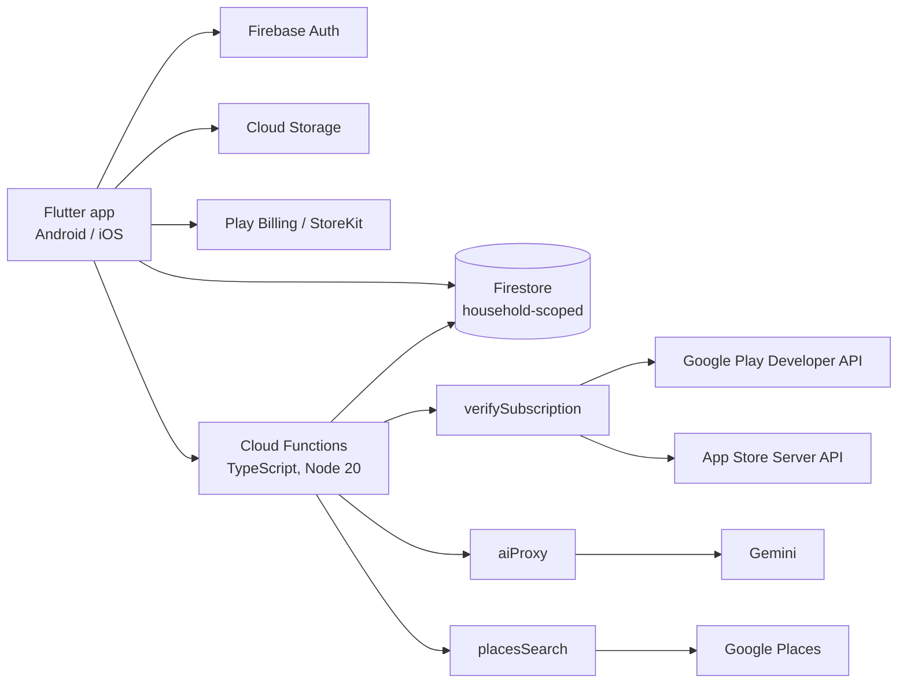

# MyPet360

One app for a household's pet health records, vaccinations, medications, appointments, reminders and documents. Family sharing for up to 6 members, an AI pet-care assistant, and paid tiers. Built with Flutter for Android and iOS.

## Status and links

- Version 1.0.10+18. Build 1.0.10+16 is submitted to Google Play production review.
- The App Store submission was rejected on 6 October 2026 under guidelines 5.1.1(v), 3.1.2(c) and 2.3.3. The fixes for all three are done.
- No public store link yet.

## Problem

Pet-care information is scattered across vet paperwork, phone notes and memory, and it is shared badly between the people who look after the same animal. MyPet360 keeps one record per household that everyone in the family can see and update. An AI assistant answers questions using the pet's own history.

## What I built

- A Flutter app with Riverpod 3 and go_router 17 (`StatefulShellRoute`), organised feature-first: 25 feature modules (`domain`, `data`, `application`, `presentation`) and 43 screens.
- English and Spanish localisation, a PDF health report, weight trend charts, and DST-correct local reminders.
- Firebase Auth (Google, email and password, and guest accounts that can be upgraded), Firestore with household-scoped data and 169 lines of security rules, and Cloud Storage with 66 lines of rules.
- Cloud Functions in TypeScript on Node 20:
  - `aiProxy`: calls Gemini with the API key held on the server (`defineSecret`) and injects the pet's history on the server;
  - `placesSearch`: a Google Places proxy for care-provider search;
  - `verifySubscription` and `startSubscriptionTrial`: server-side purchase verification and trials;
  - `deleteUserData`: account deletion.
- Tiers: Starter360 (free), Pro360 (US$6.99 a month), Family360 (US$9.99 a month), with a 15-day trial.

## Architecture

## Key technical decisions

- **Purchases are verified on the server.** Google Play purchases are checked with the Play Developer API and App Store purchases with `@apple/app-store-server-library` (pinned at 3.1.0). Sandbox and Production are routed separately, and each purchase token is bound to one purchaser so it cannot unlock a second account.
- **A StoreKit bug fixed at the root.** A purchase whose verification was decided but not entitling was never acknowledged, so StoreKit kept it queued and refused later purchases with `storekit_duplicate_product_object`. Purchases are now acknowledged on any decided verdict; only transient failures are left for redelivery.
- **One phone number, one free trial.** Phone OTP verification at sign-up stops repeat trials.
- **AI cost control.** Per-tier AI request quotas are enforced in Cloud Functions, not in the client.
- **No secrets in the app.** The Gemini and Places keys never ship in the client; the assistant's context is built on the server from Firestore.

## Stack

Flutter, Dart, Riverpod, go_router, Firebase Auth, Cloud Firestore, Cloud Storage, Cloud Functions (TypeScript, Node 20), Google Play Billing, StoreKit, Gemini, Google Places, `in_app_purchase`, `flutter_local_notifications`, `fl_chart`, `pdf`, gen-l10n.

## Testing and quality

- About 850 test cases: about 640 in Flutter (including `glados` property-based tests and `fake_cloud_firestore`) and about 205 in Cloud Functions (including Firestore-rules emulator tests and property tests).
- About 47k lines of hand-written Dart (about 61k including generated localisation code).
- Spec-driven development with Kiro. Completed specs: subscription-integrity (66/66 tasks), phone-otp-verification (58/58) and ai-request-quota (32/32).

## My role

Sole developer: Flutter app, Firebase backend, Cloud Functions and both store submissions.

Source code is private (commercial/client). Happy to walk through it in an interview.
